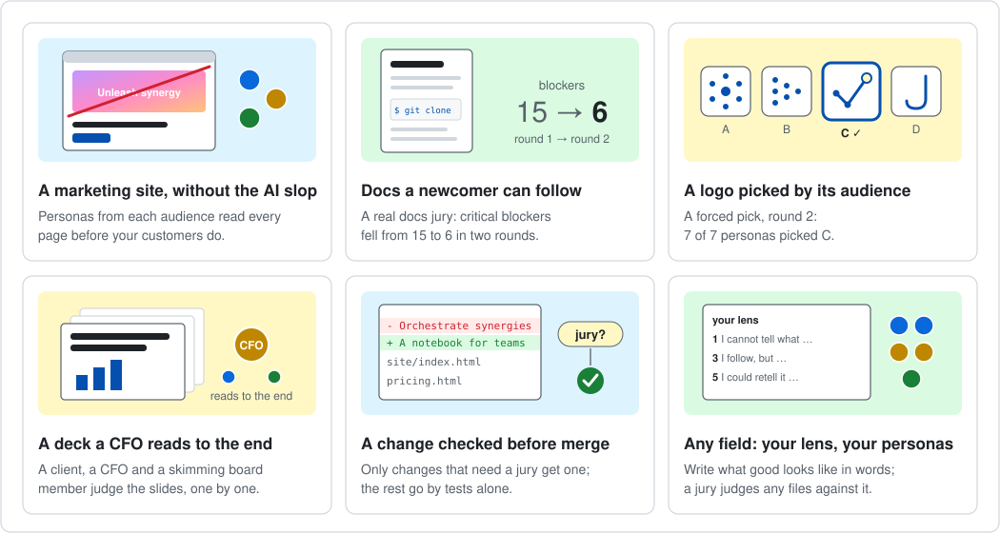
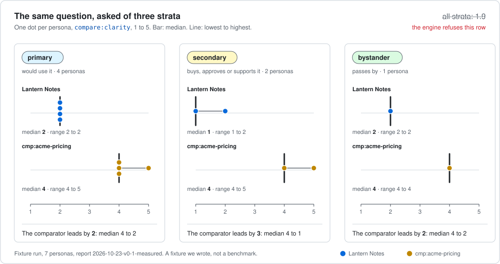
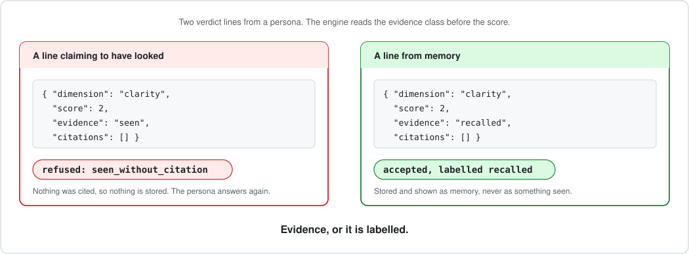
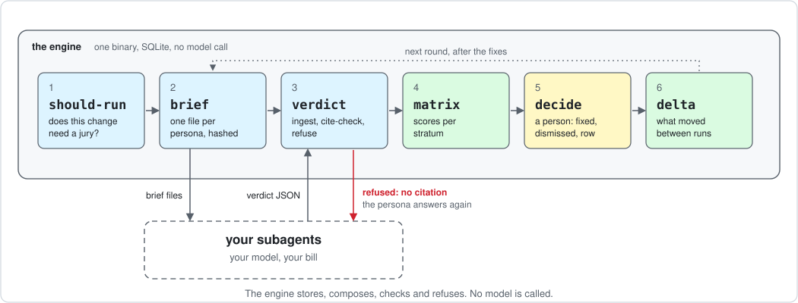
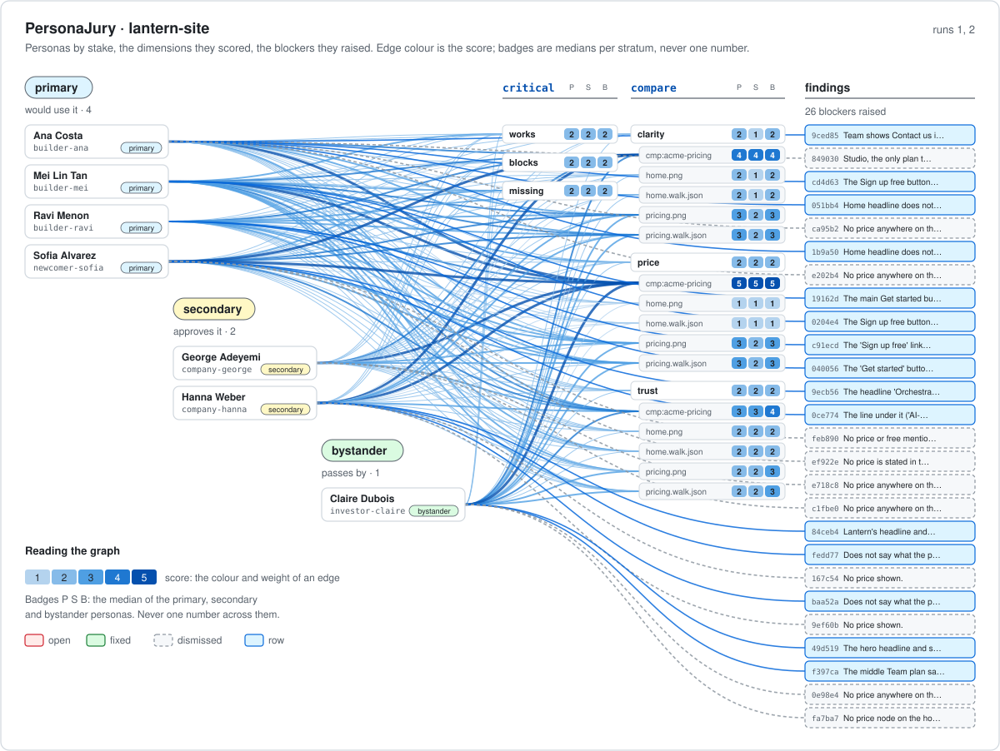
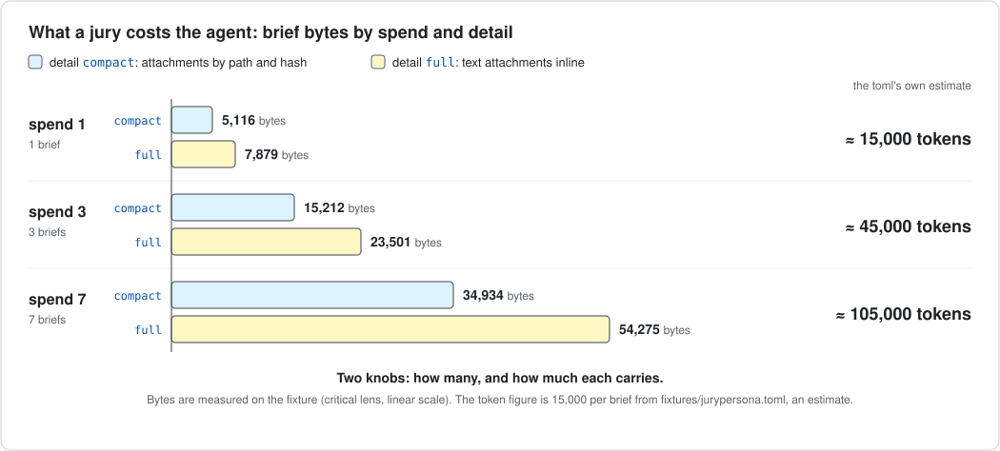
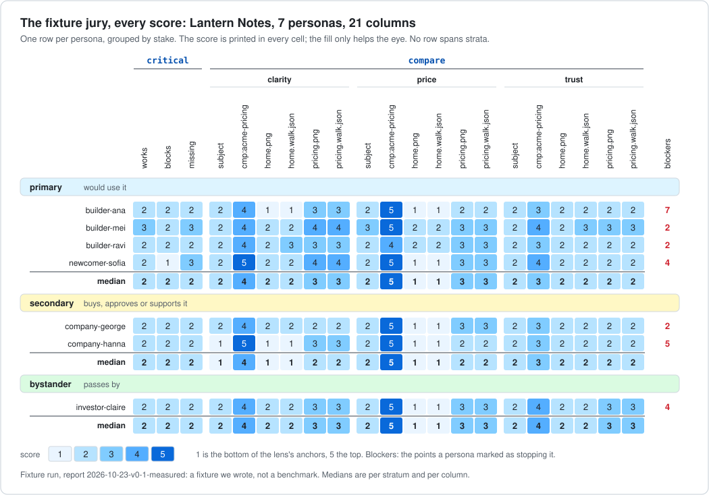

<!-- adapted from comparegraph README.md (shape only) -->
<!-- sources: docs/reports/2026-10-23-v0-1-measured.md (the fixture run); docs/reports/2026-10-24-logo-jury.md (the logo); the CompareGraph readme-jury report (linked); docs/assets/personajury-graph.svg <desc> (graph alt); docs/assets/spend.json and strata.json (figures); docs/commands.md (12, 1000, 30: the seat ceilings and the wave size); docs/decisions.md D13 to D24 (apply-check, effort seats 3, 7, 12; 0 of 8 for bars); fixtures/run/summary.txt (the summary excerpt); fixtures/run/setup.sh and verdicts/ (the replay, run as written on 2026-10-24); docs/usage.md and docs/ci.md (results, display, Desktop, the Action); docs/playbooks/README-section.md (the gallery block); fixtures/lenses/*.toml (dimension counts); scripts/install.sh and .github/workflows/release.yml (five binaries, SHA256SUMS, the attestation; the .mcpb bundles are attached when ENABLE_MCPB is set); .claude-plugin/marketplace.json and plugin.json (personajury@personajury, needs the binary on PATH); crates/personajury/src/application/setup.rs (what setup writes, the .bak backups, the rules block only beside a store); crates/personajury/tests/guards.rs and deny.toml (the no-network checks); the hero and the place of the 183-trillion line, picked by a persona jury and kept by the maintainer; docs/reports/2026-10-24-the-name-picked-by-a-persona-jury.md (8 of 11, the third run); docs/traits.md (49 traits, at most 8 per persona, the 183,098,881,048,896 count); docs/commands.md (1000 with --allow-large); docs/decisions.md D29 to D42 (the v0.6 lines); docs/walks.md; docs/own-metrics.md (the 14-line script) -->

<p align="center">
  <picture>
    <source media="(prefers-color-scheme: dark)" srcset="docs/assets/brand/lockup-dark.svg">
    
  </picture>
</p>

<h3 align="center">Put your work on trial before your customers do.</h3>

<p align="center">
  A jury of AI personas reads your page, docs, deck or code change; every juror must point at what it saw, or its verdict is thrown out; it runs inside Claude Code, Codex, Cursor and Gemini CLI, and the engine calls no model.
</p>

- **Blockers 15 → 6** on a real README in two rounds ([report](https://github.com/massrelay-ai/comparegraph/blob/main/docs/reports/2026-10-24-readme-jury.md)).
- **Our own jury named the product:** 8 of 11 picked PersonaJury ([report](docs/reports/2026-10-24-the-name-picked-by-a-persona-jury.md#the-third-run-and-the-final-name)).

<p align="center">
  <a href="https://github.com/massrelay-ai/personajury/actions/workflows/ci.yml"></a>
  <a href="https://github.com/massrelay-ai/personajury/releases/latest"></a>
  <a href="LICENSE"></a>
</p>

<p align="center">
  <a href="#try-it">Try it</a> ·
  <a href="#install">Install</a> ·
  <a href="#what-people-use-it-for">Uses</a> ·
  <a href="#proven-on-real-work">Proof</a> ·
  <a href="docs/quickstart.md">Quickstart</a> ·
  <a href="docs/faq.md">FAQ</a>
</p>

You give PersonaJury the files people would see: screenshots of a page, a document, slides, a diff. Your AI coding agent then plays a small jury of made-up readers, such as a customer, a buyer and a passer-by. Each juror scores what it read and says what stopped it. A juror that claims "I saw this" must point at a file, a line or a page element, or PersonaJury sends the answer back. You get each group's view side by side, never blended into one score, and a list of findings to fix or dismiss. It is free and open source (Apache-2.0), one program on your computer, and it never calls an AI model or the network itself.

**What you need**

- **An AI coding agent,** such as Claude Code or Codex ([the full list](#agents-and-platforms)). It plays the personas on its own model and your own plan.
- **No API key for PersonaJury.** The program keeps the jury and checks the answers; it calls no model.
- **A terminal, once,** to install it. After that you talk to your agent.

## Try it

1. **Install** on macOS or Linux ([Windows, read-first and from source](#install)):
   ```bash
   curl -fsSL https://raw.githubusercontent.com/massrelay-ai/personajury/main/scripts/install.sh | sh
   ```
   It downloads one file for your system from the [v0.6.0 release](https://github.com/massrelay-ai/personajury/releases/tag/v0.6.0),
   checks it against `SHA256SUMS`, and puts it in `~/.local/bin`. No sudo, nothing else. To read it before running it,
   see [Install](#install). To remove everything later, see [Uninstall](#uninstall).
2. **Connect your agent.** In Claude Code, type:
   ```text
   /plugin marketplace add massrelay-ai/personajury
   /plugin install personajury@personajury
   ```
   With Codex or another agent, run `personajury setup --apply` ([what it writes](#what-setup-writes)) and point the agent at the [`running-a-jury`](skills/running-a-jury/SKILL.md) skill.
3. **Ask your agent,** in your project folder, for example:
   > Use PersonaJury to run a jury on README.md: five personas who would read it. Show me the summary.

   The `running-a-jury` skill teaches the agent the steps. You read the summary and decide each finding: fixed, dismissed with a reason, or filed as an issue.

**See a finished jury first, with no agent.** The repository holds a recorded jury: seven personas on Lantern Notes, a made-up site with four planted mistakes. Replay it and open the report in your browser:

```bash
git clone --depth 1 https://github.com/massrelay-ai/personajury
personajury/fixtures/run/setup.sh personajury pj-try personajury   # 7 personas, 14 briefs
cd pj-try && v=../personajury/fixtures/run/verdicts                # the recorded answers
for f in $v/*--critical.json; do personajury verdict --run 1 --file "$f"; done
for f in $v/*--compare.json; do personajury verdict --run 2 --file "$f"; done
personajury summary 1 2 --html jury.html                           # open jury.html
```

The report opens with "The jury says: escalate. Primary jurors raised 15 blockers", then each group's scores, the forced picks and the jury drawn as a graph. Each command prints one line of JSON; `--pretty` makes it readable.

**[Proven on real work](#proven-on-real-work).** A docs jury cut a sibling project's critical blockers from 15 to 6, and its README went from 4 of 7 picks to 7 of 7. A fixture jury found all four planted defects.

---

## What people use it for

<p align="center"></p>

- **A marketing site, without the AI slop.** Personas from each audience read every page and flag vague, generic copy before your customers see it ([playbook](docs/playbooks/marketing-site.md)).
- **Docs a newcomer can follow.** A real jury on a sibling project's README cut the blockers it found from 15 to 6 in two rounds ([playbook](docs/playbooks/docs-and-readme.md)).
- **A logo picked by its audience.** Our own logo was chosen by a forced pick: 7 of 7 personas picked the same mark in round 2 ([playbook](docs/playbooks/pick-a-name-or-logo.md)).
- **A deck a CFO reads to the end.** A client, a CFO and a skimming board member read your slides and say where they got lost ([playbook](docs/playbooks/deck-or-pitch.md)). No coding agent? The [chat route](#agents-and-platforms) pastes one brief per chat window; it still needs the terminal for the brief.
- **A change checked before merge.** Rules say which changes need a jury, so a typo goes by tests and a new pricing page goes before personas ([playbook](docs/playbooks/a-change-in-a-pull-request.md)).
- **Any field: your lens, your personas.** Write what good looks like in plain words, and a jury can judge any files against it ([all playbooks](docs/playbooks/README.md)).

## Words used here

- **Persona:** a made-up reader with a role, daily tasks and fears, written as a small JSON file. Personas are composites, never real people.
- **Stake, or stratum:** how much the persona has riding on it. `primary` would use it, `secondary` buys, approves or supports it, `bystander` passes by. Each stratum is reported on its own.
- **Trait:** a tendency a persona holds, such as price consciousness, on a scale of 1 to 5 or as a category. The juror is told it; it is not proven.
- **Lens:** what the jury scores, with what a 1, a 3 and a 5 look like, in words. `critical` asks: does it work, what blocks me, what is missing.
- **Brief and verdict:** the brief is one persona's instructions, written by PersonaJury; the verdict is that persona's answer, as JSON.
- **Subagent:** a separate helper your agent starts, one per persona, so jurors do not read each other's answers.
- **MCP:** the standard way agents call tools. `personajury mcp` serves PersonaJury's commands to your agent.
- **The store:** `.personajury/store.db` in your project, a SQLite file (one ordinary file) that keeps every run.

## Install

Release binaries for Linux x64 and arm64, macOS arm64 and x64, and Windows x64, each listed in the release's `SHA256SUMS`. Anywhere else, build from source.

The install script downloads one file, the `personajury` binary for your platform, checks it against `SHA256SUMS`, and copies it to `~/.local/bin` (`PERSONAJURY_INSTALL_DIR` moves it). It does not use `sudo` and changes nothing else. To read it before it runs:

```bash
# the script as tagged for v0.6.0: download it, read it, run it pinned to that release
curl -fsSLO https://raw.githubusercontent.com/massrelay-ai/personajury/v0.6.0/scripts/install.sh
less install.sh
PERSONAJURY_VERSION=v0.6.0 sh install.sh
```

- **By hand, and on Windows:** download your platform's file (`personajury-linux-x64`, `personajury-darwin-arm64`, `personajury-win32-x64.exe`, …) and `SHA256SUMS` from the [latest release](https://github.com/massrelay-ai/personajury/releases/latest). Check it with `sha256sum -c --ignore-missing SHA256SUMS` (macOS: `shasum -a 256 <file>`; Windows: `Get-FileHash <file>`) and compare with its line. Rename it `personajury` (`personajury.exe` on Windows) and put it on your `PATH`.
- **Provenance:** the release workflow signs a build-provenance attestation over the binaries and `SHA256SUMS`. The script checks the checksum only; check the attestation yourself with GitHub CLI 2.49 or later: `gh attestation verify personajury-linux-x64 -R massrelay-ai/personajury`.
- **From source,** with Rust 1.85 or newer:
  ```bash
  cargo install --locked --git https://github.com/massrelay-ai/personajury personajury
  ```

Then connect your agents:

```bash
personajury setup            # a plan: what it would write, and where; writes nothing
personajury setup --apply    # writes it
personajury doctor           # the store, the counts, and each agent's registration
```

In Claude Code, the plugin does this instead (`/plugin marketplace add massrelay-ai/personajury`, then `/plugin install personajury@personajury`); it needs the binary on your `PATH`.

### What `setup` writes

`setup --apply` only adds, and backs up every file it changes as `<file>.bak-<unix-seconds>` beside it. For each agent it finds:

- a `personajury` MCP server entry in that agent's config, such as `~/.claude.json`, `~/.codex/config.toml` or `~/.gemini/settings.json` (`--scope project` writes the project's own file instead, such as `.mcp.json` or `.cursor/mcp.json`);
- for Claude Code, a SessionStart hook in `~/.claude/settings.json` that runs `personajury doctor --brief` (`--no-hook` skips it);
- in a folder that already holds a `.personajury/` store, a short block between `<!-- personajury -->` markers in `CLAUDE.md`, `AGENTS.md` or `GEMINI.md` that tells the agent about the jury (`--no-rules` skips it).

An entry named `personajury` that points elsewhere is left alone unless you pass `--force`. `--client NAME` limits it to one agent.

### Uninstall

There is no uninstall command yet. By hand:

1. Claude Code: `/plugin uninstall personajury@personajury`, then `/plugin marketplace remove personajury`.
2. Other agents: run `personajury doctor` to list the files that hold a `personajury` entry, and delete that entry, the `<!-- personajury -->` block and the hook. A `.bak-` file beside each one holds the file as it was before `setup` changed it.
3. The binary: delete `~/.local/bin/personajury` (or wherever you put it), or `cargo uninstall personajury`.
4. Your juries: each project's `.personajury/` folder. Keep a copy first if you want one: `personajury summary RUN... --md jury.md` writes a report, and `store.db` is a plain SQLite file any SQLite tool reads.

## The loop by hand

What the agent does for you, on the fixture site in this repository. Each comment says what the next line does:

```bash
git clone https://github.com/massrelay-ai/personajury && cd personajury
# seven personas, each a JSON file
for f in fixtures/personas/*.json; do personajury persona add --file "$f"; done
# who sits on the jury, and with which stake
personajury panel add fixture \
  --query "3 builder=primary, 1 newcomer=primary, 2 company=secondary, 1 investor=bystander"
# what they judge, as files: the site's page walks and screenshots
personajury subject add lantern-site --kind page --attach fixtures/site-walk/*
# one brief per persona, for the critical lens
personajury brief --subject lantern-site --panel fixture --lens critical --model sonnet
# here the agent starts one subagent per brief; each writes one verdict JSON, such as:
personajury verdict --run 1 --file verdicts/builder-ana.json
# (a verdict without evidence is refused, and that juror answers again)
# sentences first, then the scores per stratum
personajury summary 1
# your word on each finding: fixed, dismissed --why "...", or row --row ISSUE-12
personajury decide <finding> fixed --by me
# exits 1 while a finding has no decision
personajury check
```

Every command prints one JSON envelope (`--pretty` to read it). The full walk, with comparators and the second round, is [`docs/quickstart.md`](docs/quickstart.md).

## Why PersonaJury

An agent asked "is this page good?" answers with confidence and no evidence. One number then hides that the people who pay and the people who pass by disagree. PersonaJury is three laws, each enforced by a refusal:

1. **The engine never calls a model.** It stores personas, panels, lenses and subjects, writes the briefs and checks the verdicts. Your agent runs the personas on its own model and its own bill. The engine makes no network call either: `deny.toml` bans every HTTP client crate in CI, and two tests in [`crates/personajury/tests/guards.rs`](crates/personajury/tests/guards.rs) fail on a network crate in `Cargo.lock` or a `std::net` socket in the source.
2. **Evidence, or it is labelled.** Every verdict line is `seen` (it cites an attachment of the run: an ARIA node, a screenshot, a diff line), `told` (the brief said it) or `recalled` (the model's memory, shown as such). A `seen` line with no citation is refused, and the persona answers again.
3. **Strata are never averaged.** Each persona has a stake: `primary` (would use it), `secondary` (buys, approves or supports it) or `bystander` (passes by). Scores are reported per stratum, side by side. The engine refuses the table that pools them.

<p align="center"></p>

<p align="center"></p>

## How it works

<p align="center"></p>

`should-run` says whether a change needs a jury. `brief` writes one hashed brief per persona. Your agent's subagents answer, and `verdict` ingests or refuses each answer. `matrix` reports per stratum. `decide` closes each finding as `fixed`, `dismissed` (with a why) or `row` (an issue). `delta` says whether the next round landed. `apply-check` says, last, whether the agent may apply the fixes.

**Any audience, from 183 trillion possible juror profiles.**<sup>[1](docs/traits.md#how-many-juror-profiles)</sup> 49 research-based traits, from risk appetite to corporate distrust, combine into the seats your change needs. Generate thousands; seat up to 1,000 in a run. Each trait cites its research; the catalog is in [`docs/traits.md`](docs/traits.md).

<sub>1. 49 traits × 5 levels, up to 8 per persona.</sub>

`personajury graph` draws the whole fixture jury as one picture. Read it left to right: the personas, grouped by stake; the dimensions they scored, each with one median per stratum; the findings they raised, outlined by what was decided.

<p align="center"></p>

- **Rules pick the panel per audience.** `brief --rule CLASS` takes the panel, lenses, spend and detail from `personajury.toml`, one run per lens.
- **A seeded draw.** When a pool holds more personas than seats, the seats are drawn from the subject's name, so round 2 meets the same jurors and `delta` can land.
- **Agent overrides carry a reason.** The agent may change a rule's panel, spend, lens or detail, but each change needs `--reason`, and `matrix` shows it. A brief seats at most 12 without a reason, up to 1000 with `--allow-large`.
- **Waves.** Every brief lists its jurors in waves of 30 (`--wave N`). The agent runs a wave, ingests it, then the next.
- **Reported usage beside the estimate.** A verdict may carry the tokens the agent spent. `matrix` and `doctor` show that sum, labelled "reported by the agent", beside the estimate. The engine measures no token.
- **`graph --svg`.** The jury as one deterministic picture, the one above. Over several runs, each finding shows its life.
- **`check --history`.** Each finding's life across runs: raised, raised again after a fix, fixed, not judged, absent.

**The spend dial.** `--spend N` takes the first N personas of the panel, primary first. `--detail compact|full` sets how much each brief carries. Every brief answers its byte size and an estimate before anything is spent.

<p align="center"></p>

Measured by `scripts/readme-assets-data.sh` ([`docs/assets/spend.json`](docs/assets/spend.json)); the token figure is the project's own estimate, not a measurement.

### New in v0.6

- **Traits and trait sets.** A persona may hold up to 8 traits, such as price consciousness; a set picks the traits a kind of subject needs, and `brief --traits` tells each juror "you tend to ..." ([traits](docs/traits.md)).
- **`--seats auto`.** The brief seats the personas who serve the subject's audience, plus one control who does not, and says why each one sits.
- **Decision juries.** Give questions and options instead of a page; the jury picks per question, and a money or legal question goes to a person.
- **Deliberation, advise only.** `personajury deliberate` lets jurors read each other once; the run can then only advise.
- **Honest metrics.** Agreement, shift, panel match and cost, counted per stratum, never a mean.
- **`trait suggest` and `trait observed`.** Traits read back from a persona's prose (with quotes) or from its verdicts (with counts). They show how a persona was played, not how real people are.
- **Page walks:** `node tools/walk.mjs` captures an ARIA walk and screenshot of any page ([docs/walks.md](docs/walks.md)).
- **Your own metrics.** `personajury export RUN --format csv` gives the raw rows; a 14-line script counts what you need, per stratum ([docs/own-metrics.md](docs/own-metrics.md)).

### The last word: `apply-check`

`personajury apply-check RUN...` answers one of four words, with its reasons as data. The agent runs it last and obeys it. It applies nothing itself.

- **`apply`**: the agent may apply the fixes.
- **`advise`**: something is unknown, missing or lowered. The findings still help; the agent does not apply them on its own.
- **`escalate`**: a primary blocker, a split between strata, a finding with no decision, or a delta that did not land. Run the next quorum up.
- **`human`**: money, permission, deploy, secret, licence, public claim or brand. A person decides.

`apply` needs every condition proven: every seat answered, a known quorum, the run under its rule and not cut down, independent jurors, a current subject, the delta landed, `check` clean. A guess must never pass a change, so anything unproven advises ([D13](docs/decisions.md)).

### Cost, independence, experts

- **Effort.** One word sets what a jury may spend: `effort = "low|medium|high|max"` in `personajury.toml`, or `brief --effort`. Under a rule, `low` seats 3 with one lens, `medium` (the default) at most 7, `high` at most 12. Every cap keeps one seat per stratum.
- **`budget_tokens`.** An optional cap on the estimate. The brief trims lenses, then seats, to fit, and records each cut. A cheap jury on a `high` quorum only advises.
- **Independence.** A run is `independent` (one context per brief) or `sequential` (one context reads every brief, as in Claude Desktop or a chat window). Sequential runs only advise.
- **Experts and human verdicts.** A persona may carry a `credential`, and a lens a named `standard`. A real person's verdict goes in with `verdict --by-human "<name, credential>"`. It stands beside the jury, never in a median, and a blocker it raises escalates until a person closes it. An agent cannot enter one.
- **A model per panel term.** `3 builder=primary@claude-sonnet-5-5` names the model in those seats' briefs. `matrix` shows which models answered.
- **`lens generate`.** `lens generate --from handbook.md` writes a brief that asks your agent to draft a lens from your own standard. `lens add` checks the draft.
- **`calibrate`.** `calibrate JURY_RUN HUMAN_RUN` compares the jury's rank order with real people's, per stratum. Given that file, `apply-check --calibration` advises when a primary cell is off by more than one rank.

### Reading the answer: `summary`

`personajury summary RUN...` writes sentences first, then the numbers for checking, then what to do next. There are no bars: a display jury of eight gave bars 0 picks ([D24](docs/decisions.md)). The fixture run, from [`fixtures/run/summary.txt`](fixtures/run/summary.txt):

```text
PersonaJury summary: lantern-site, runs 1 2 (critical, compare)

The jury says: escalate. Primary jurors raised 15 blockers, the groups disagree
on 2 scores, and 26 findings have no decision yet.
Even without that, the jury could only advise: no rule was given.
...
Numbers, for checking (medians primary·secondary·bystander; - = nobody):
                   works  blocks  missing  clarity  price  trust
cmp:acme-pricing   -      -       -        4·4·4    5·5·5  3·3·4
pricing.png        -      -       -        3·2·3    3·2·3  2·2·3
pricing.walk.json  -      -       -        3·2·3    3·2·3  2·2·3
lantern-site       2·2·2  2·2·2   2·2·2    2·1·2    2·2·2  2·2·2
...
Next: run the high quorum with these reasons in hand before applying anything.
```

`--md` and `--html` write the same summary as a file. The MCP tool is `personajury_summary`.

### In CI and in your own code

- **The GitHub Action** ([`action.yml`](action.yml), [`docs/ci.md`](docs/ci.md)) classifies a pull request with `should-run`. With a committed store it also runs `check` and `apply-check`. It calls no model and needs no secret. By default `human`, `escalate` or an engine error fails the job. It installs the release binary through `scripts/install.sh`, checksum checked. Unverified on GitHub: it is tested against a local binary.
- **The Claude Agent SDK recipe** ([`docs/agent-sdk.md`](docs/agent-sdk.md)) runs one SDK session per brief, so each juror has its own context. A coordinator ingests the verdicts through `personajury mcp`. A test checks only that the example compiles; running it needs your own key.

## Where results live

The store, `.personajury/store.db`, is the record. It is append-only, and it does not belong in git unless CI reads it. Reports are views of the store. They are written only when you ask (`summary --md` or `--html`), or into the `report_dir` named in `personajury.toml` by `summary --save`. With no `report_dir`, nothing is written ([`docs/usage.md`](docs/usage.md#where-results-live)).

## Display is free, the verdict is not

Any agent may restyle what the engine returns, with two rules: never pool strata, and never write a number the data lacks. `apply-check` is different. It is a verdict, and it binds only where you wire it: the Action, a Claude Code hook, a git hook or your own gate. The recipes are in [`docs/usage.md`](docs/usage.md#display-is-free-the-verdict-is-not).

## Proven on real work

Three runs, each with its report. The personas are composites, not a survey: they show where to look, and they do not replace real users.

| run | what the jury judged | result |
|---|---|---|
| **The fixture** | Lantern Notes, a made-up site with four planted defects; seven personas over three strata | all four planted defects found; 14 verdicts accepted, 0 refused; 26 findings, one false positive ([report](docs/reports/2026-10-23-v0-1-measured.md)) |
| **CompareGraph's docs** | a sibling project's README, usage, FAQ and troubleshooting, under three lenses, against two other projects' READMEs | critical blockers from 15 to 6, compare blockers from 6 to 0; all three deltas landed; the forced pick went from 4 of 7 to 7 of 7 ([report](https://github.com/massrelay-ai/comparegraph/blob/main/docs/reports/2026-10-24-readme-jury.md)) |
| **This logo** | four directions, then the winner against two refinements | C won 6 of 7 picks, then 7 of 7; the refinements lost legibility at 16 px, so C ships as drawn ([report](docs/reports/2026-10-24-logo-jury.md)) |

The fixture is ours, so it proves the loop, not a benchmark. In the CompareGraph run the engine did not change; only the words did. The secondary stratum still says `blocks: 2` there, because better words cannot close a missing CI check.

<details>
<summary><b>Every score of the fixture jury</b></summary>

<p align="center"></p>

</details>

## What a jury can judge, beyond code

Anything people read or look at, as long as you can attach it as files. The jury never fetches a live page.

| subject | as files | the strata: primary / secondary / bystander | a lens |
|---|---|---|---|
| Product pages and docs | an ARIA walk and screenshots per page; the markdown | users / the buyer or approver / a passer-by | `critical`, `compare`, `taste` |
| Slides and consulting decks | a PDF export, one PNG per slide, the speaker notes | the client team who acts / the partner who signs off / an executive who reads only the titles | [`consulting-deck`](fixtures/lenses/consulting-deck.toml) |
| Investor pitches | the deck as PDF and PNGs, the one-pager | investors in your sector / their partners / a generalist angel | [`investor-pitch`](fixtures/lenses/investor-pitch.toml) |
| Financial models (readability, not correctness) | a CSV or PDF per sheet, the summary as a screenshot | the credit analyst / the credit committee / a board member | [`financial-model`](fixtures/lenses/financial-model.toml) |
| Business plans and policy briefs | the document and its charts | who must act on it / who approves it / a reader from the public | `critical` |
| Pricing | the pricing page as walk and screenshot; rivals' pages as comparators | who pays / who approves the spend / someone shopping around | `compare`, with a forced pick |
| Logos and design | one board per candidate: small and large, light and dark | the users / the approvers / a passer-by | your own lens with a forced pick, as the [logo jury](docs/reports/2026-10-24-logo-jury.md) did |
| Technical decisions (the trade-offs, not correctness) | one text file per option: a README excerpt, a usage snippet, the licence, the release cadence | the maintainer and an SRE / a security reviewer and a new hire / a finance approver | [`tradeoffs`](fixtures/lenses/tradeoffs.toml), with a forced pick |

The three sector lenses and `tradeoffs` ship as data in `fixtures/lenses/`, not seeded: `personajury lens add --file fixtures/lenses/investor-pitch.toml`. Each sector lens has four dimensions and `tradeoffs` has five, with anchors in words at 1, 3 and 5.

Worked stories: [choose between technical options](docs/playbooks/a-technical-decision.md), [your own juror, a devil's advocate, real people](docs/playbooks/your-own-jurors.md), and [all playbooks](docs/playbooks/README.md).

**What a jury must not judge:**
- **Correctness.** Tests do that. A financial-model jury reads the model; it never checks the arithmetic.
- **Money, legal, permissions and deploys.** A person decides; the jury advises. The engine refuses a config that puts these under a persona quorum.
- **Real users, when you have them.** Personas tell you where to look. Real people overrule them.

## Lenses

A lens is a set of dimensions with anchors in words: what a 1, a 3 and a 5 look like. It is versioned data in TOML; an edited anchor is a new version ([`docs/lenses.md`](docs/lenses.md)).

| lens | asks | ships as |
|---|---|---|
| `critical` | works, blocks, missing | seeded |
| `taste` | look, type, motion, voice, against a design standard the project names | seeded |
| `compare` | clarity, price, trust, against named comparators held as snapshots; the persona also picks one | seeded |
| `recall` | first-read, would-return: a cheap first impression, always `recalled` | seeded |
| `consulting-deck` | storyline, action-titles, evidence, the-ask | `fixtures/lenses/` |
| `investor-pitch` | problem, why-now, proof, the-ask | `fixtures/lenses/` |
| `financial-model` | assumptions-visible, sensitivities, risks-stated, a-lender-would-sign | `fixtures/lenses/` |
| `tradeoffs` | fit, risk, cost-to-change, operability, learning-curve; the persona also picks one option | `fixtures/lenses/` |
| `site` | six criteria on a 1 to 10 scale, for the held-out check | `fixtures/lenses/` |

Add your own with `personajury lens add --file my-lens.toml`; `personajury lens list` shows them.

## What the engine refuses

Each refusal is a test that was seen failing first. The codes are in [`docs/troubleshooting.md`](docs/troubleshooting.md).
- a `seen` line with no citation, or a citation that names no node, attachment or line of the run;
- a comparison with a comparator the run holds no snapshot of (it may be stored only as `recalled`);
- a score off the lens's scale or on a dimension it lacks; a dimension scored twice or not at all; a bottom score with no blocker;
- a table that averages across strata;
- a verdict for a run whose subject changed since the brief, or from a persona with no stake in the run;
- a `pick` without a reason;
- a rule override, or a brief above 12 seats, without a reason;
- a decision on a finding a person raised, unless a person makes it;
- reported usage in any shape but two non-negative token counts;
- a `personajury.toml` that puts a human class under a persona quorum.

## Not every change needs a jury

`personajury.toml` holds trigger rules as data ([`fixtures/personajury.toml`](fixtures/personajury.toml) is an example). `should-run` classifies a diff:

| quorum | who decides |
|---|---|
| `none` | tests and an adversarial read: internals, migrations, tests |
| `low` | three personas, one lens; the agent applies the fixes only when `apply-check` says `apply` |
| `high` | the full panel, all lenses; a foreman proposes the fixes |
| `human` | a person; the jury only advises |

The human classes are money, permission, deploy, secret, licence, public-claim and brand. A split or any primary blocker escalates one level; `apply-check` computes that.

**What a citation proves.** That the persona was given the attachment and named a node that exists in it. Not that it looked, read well or is realistic. Colour and layout reach the jury only through screenshots, and image regions are not checked. A published matrix means something only with its subject, panel, lens and brief hashes beside it ([`docs/publishing-results.md`](docs/publishing-results.md)).

## Agents and platforms

`personajury setup` registers the MCP server with Claude Code, Codex, Cursor, Gemini CLI, OpenCode, Hermes, Windsurf, Antigravity, Kiro, GitHub Copilot, Copilot CLI and Qwen Code; any other MCP client can run `personajury mcp`. The CLI does everything the tools do. Release builds: Linux x64 and arm64, macOS arm64 and x64, Windows x64. Two skills, [`running-a-jury`](skills/running-a-jury) and [`writing-a-persona`](skills/writing-a-persona), teach your agent the loop.

- **Claude Desktop:** drop a `.mcpb` bundle on the app. The release attaches the bundles (or build one with `scripts/build-mcpb.sh <platform> <binary>`). Desktop has no subagents, so brief with `--independence sequential`; those runs advise and never apply. Unverified: no maintainer has installed a bundle by hand yet.
- **A chat window:** no server, files only. `brief --chat-pack pack.md` writes one file to paste into a chat; save its answer and run `verdict --run N --from-chat answer.md` ([`docs/usage.md`](docs/usage.md#web-chat)).
- **CI:** the GitHub Action ([`docs/ci.md`](docs/ci.md)). Unverified on GitHub: tested against a local binary only.
- **Your own code:** the Claude Agent SDK recipe ([`docs/agent-sdk.md`](docs/agent-sdk.md)).

## Docs

- **Start here, no code needed:** [Playbooks](docs/playbooks/README.md), short stories of a jury doing a real job (a site, docs, a logo, a deck), and the [FAQ](docs/faq.md).
- **Running juries:** [Quickstart](docs/quickstart.md) · [Usage](docs/usage.md) · [Troubleshooting](docs/troubleshooting.md) · [CI](docs/ci.md) · [Agent SDK](docs/agent-sdk.md)
- **Reference:** [Commands](docs/commands.md) · [MCP tools](docs/mcp-tools.md) · [Lenses](docs/lenses.md) · [Decisions](docs/decisions.md) · [Reports](docs/reports/README.md) · [Changelog](CHANGELOG.md) · [All docs](docs/README.md)

## Contributing

Read [`CONTRIBUTING.md`](CONTRIBUTING.md) and [`AGENTS.md`](AGENTS.md). Tests first; a new refusal is a test seen red before it existed. Personas are composites, never real people ([`PERSONAS.md`](PERSONAS.md)). Security: [`SECURITY.md`](SECURITY.md). Governance: [`GOVERNANCE.md`](GOVERNANCE.md). Help: [`SUPPORT.md`](SUPPORT.md).

## Licence

Apache-2.0 ([`LICENSE`](LICENSE)). Files adapted from our sibling CompareGraph are listed in [`docs/THIRD_PARTY_NOTICES.md`](docs/THIRD_PARTY_NOTICES.md).
