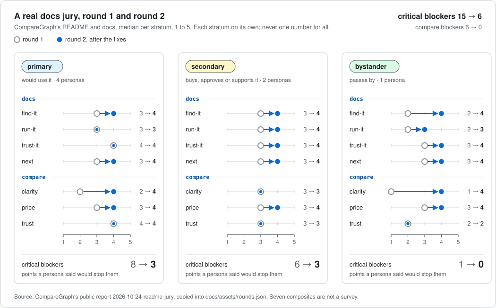

<!-- sources: CompareGraph's public report docs/reports/2026-10-24-readme-jury.md (every number below; linked); docs/assets/rounds.json (the chart's data, copied from it) -->

# Make docs a newcomer can follow

A true story. CompareGraph is PersonaJury's sibling project. Before its README went out, seven personas read it, the team
fixed what they found, and the same seven read it again. Every number here comes from
[the public report](https://github.com/massrelay-ai/comparegraph/blob/main/docs/reports/2026-10-24-readme-jury.md).

## What was judged

The pages a newcomer reads first: the README, the usage page, the FAQ and the troubleshooting page. Plus pictures of the
README's charts, and a screenshot of the README's first screen as GitHub shows it. The jurors judged files, never a live
page.

## Who judged

Seven made-up personas in three groups:
- **would use it (primary):** an open-source maintainer, a platform engineer checking a vendor, an author of agent skills,
  and a newcomer with one free evening;
- **approves it (secondary):** an engineering manager and a security reviewer;
- **passes by (bystander):** a newsletter writer who reads the first screen only.

## Three lenses

- `critical`: does it work, what stops me, what is missing.
- `docs`, a lens the team wrote: can I find it, run it, trust it, and do I know what to do next.
- `compare`: against two rival projects' READMEs, which is clearer, cheaper to start, more trusted, and which would I try
  first.

## Round 1: what the jury said

- **The first screen** was 27 badges and a list of agents before any sentence saying what the tool does. The passer-by
  left before the first sentence.
- **The first run** assumed you had already cloned the repository, and said nothing about how long it takes.
- **Trust:** the install line piped a script straight into a shell, and nothing said what the tool does with a repository
  you do not trust.

## What changed

The team decided every finding: 16 fixed in the docs, 4 opened as issues (true, but code problems, not words), and 2
dismissed (they were about a rival's README).

The fixes were plain: one sentence and three badges on the first screen, a picture of what the tool produces, an install
route you can read before you run, a sample that starts at `git clone`, and FAQ answers on cost, support and safety.

## Round 2: the same jury, the edited pages

- **Critical blockers fell from 15 to 6.** Per group: 8 to 3, 6 to 3, 1 to 0.
- **Compare blockers fell from 6 to 0.**
- **Clarity against the rivals** went from 2 to 4 for the people who would use it, and from 1 to 4 for the passer-by.
- **The forced pick** ("which would you try first") went from 4 of 7 for this README to 7 of 7.
- `delta` said the fixes landed on all three lenses. `check` passed: none of the 16 fixes was raised again.

## What the numbers do not say

- **The security reviewer still says "blocks: 2".** The gaps are real: no test that enforces "no network", no software
  bill of materials. Better words cannot close them. Only code can.
- **"Run it" stayed at 3** for the primary group. Not every score moves.
- **Scores are relative to the rivals in the room.** Change the rivals and the numbers change.
- **Seven composites are not a survey.** They tell you where to look.

## Do it on your own docs

1. Attach the pages as files, plus a screenshot of the first screen.
2. Pick personas: someone who would use it, someone who approves it, someone who passes by. Put a true newcomer in the
   first group.
3. Run `critical` and `compare` (with two rivals' READMEs saved as comparators), plus a `docs` lens of your own:
   four dimensions, each with its scores written in words ([lenses](../lenses.md)).
4. Decide every finding: fixed, dismissed with a reason, or an issue.
5. Edit. Run the same personas again. Run `delta` and `check`.

The front door is often the biggest problem, and the cheapest to fix.
