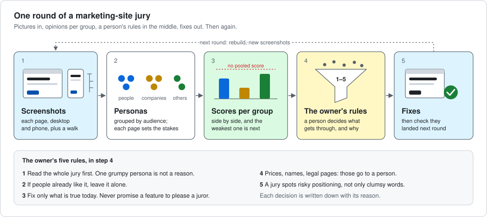

<!-- sources: fixtures/README.md (Lantern Notes, the four planted defects D1–D4); fixtures/personas/*.json (the seven personas, their stake_rules); fixtures/run/setup.sh (the commands); docs/assets/strata.json (compare:clarity medians); fixtures/run/picks.json (the forced pick); fixtures/run/decisions.jsonl (26 findings: 15 row, 11 dismissed); lenses/taste.toml; docs/lenses.md (standard, asks_pick); docs/commands.md -->

# Fix a marketing site before people see it (and keep the AI slop out)

A story on **Lantern Notes**, the made-up site in [`fixtures/`](../../fixtures/README.md). It is a shared notebook for small
teams. We planted four mistakes in it. Nothing on it can be bought.

You will need an agent that can run subagents (Claude Code, Codex, Cursor, …) and PersonaJury installed. You do not need to
read code. You need to read what the jury says, and decide.

<p align="center"></p>

## 1. Take pictures, not a link

The jurors never visit the site. They get files. That way every juror sees the same thing, and every claim can point at
something.

For each page, take:
- a desktop screenshot (1280 × 800);
- a phone screenshot (about 390 × 844), if phones matter to you;
- a **walk**: the page's headings, buttons and links as a list. Colour does not show in a walk. Text does not lie in a
  screenshot. You want both.

```bash
google-chrome --headless=new --window-size=1280,800 --screenshot=home.png  site/index.html
google-chrome --headless=new --window-size=390,844  --screenshot=home-phone.png site/index.html
```

Lantern Notes has two pages, home and pricing, each as a PNG and a walk (`fixtures/site-walk/`).

## 2. Pick personas by audience

Ask who reads this site, and why. Group them. For Lantern Notes we wrote seven personas in four groups:
- **people:** Sofia, a student who has never heard of the product;
- **builders:** Ana, Mei and Ravi, who might use it every day;
- **companies:** George and Hanna, who approve the spend;
- **others:** Claire, an investor passing by.

The stakes change per page. Each persona file says how. Sofia is *primary* on the home page, *secondary* on pricing (she
only checks it is free), and a *bystander* on an admin page. The company personas matter most on a page for companies.
Give each page its own stakes with `--stake`.

Write personas from real material when you have it: support tickets, sales notes, interviews.
[`writing-a-persona`](../../skills/writing-a-persona) shows how.

## 3. Choose the lenses

A lens is the question the jury answers, with the scores written in words. Use four.

| lens | the question | on Lantern Notes |
|---|---|---|
| `critical` | Does it work? What stops me? What is missing? | found the dead "Sign up free" link and the hidden Team price |
| `taste` | Does it look and sound cared for, or generic? | give it your slop signals (below) |
| `compare` | Against a rival's page, which is clearer, cheaper, more trusted? | the rival "Acme Pads" pricing page, held as a screenshot |
| a forced pick | Which one would you choose, and why? | for a naming question: see [pick a name or logo](pick-a-name-or-logo.md) |

The commands, as the fixture runs them ([`fixtures/run/setup.sh`](../../fixtures/run/setup.sh)):

```bash
personajury subject add lantern-site --kind page --attach home.walk.json home.png pricing.walk.json pricing.png
personajury comparator add acme-pricing --kind prices --attach acme/pricing.walk.json acme/pricing.png
personajury brief --subject lantern-site --panel fixture --lens critical,compare --comparator acme-pricing \
  --stake "builder-ana=primary,...,investor-claire=bystander" --model claude-sonnet-5-5
```

Your agent then gives each brief to its own subagent. Each one answers alone. An answer that claims to have *seen*
something must point at it. If it does not, the engine sends it back.

### Slop signals

AI-written sites drift to the same look and the same words. Name the signals, and the jury will look for them. Put this
list where your taste lens's `standard` points (a file in your repo), and write the 1-anchors to match.

<a id="slop-signals"></a>
- A headline that does not say what the product does.
- Vague superlatives: "seamless", "revolutionary", "next-level", "unlock", "supercharge".
- Jargon stacks: "orchestrate asynchronous knowledge synergies".
- A purple-to-pink gradient hero with no picture of the product.
- Small capital "kicker" labels above every heading.
- Stock icons in a row of three identical cards.
- Sparkles, rockets and emoji in place of a reason.
- Testimonials with no name, numbers with no source.
- Every section the same shape: icon, bold line, two lines of grey.
- A button that says "Get started" and does not say what starts.

A taste lens for this, as a file you load with `personajury lens add --file`:

```toml
name = "taste-site"
version = 1
scale = [1, 5]
asks_pick = false
evidence = ["seen", "told", "recalled"]
standard = "docs/slop-signals.md"   # your copy of the list above

[[dimension]]
id = "voice"
title = "Words that say something"
anchors = { "1" = "hype or jargon from the slop list; I cannot say what it does", "3" = "plain but generic; it could be any product", "5" = "plain, specific, one voice; I could repeat the headline to a friend" }

[[dimension]]
id = "look"
title = "A look that is its own"
anchors = { "1" = "a template: gradient hero, three icon cards, kicker labels", "3" = "clean, but I would not recognise it again", "5" = "every block shows the product or earns its place" }
```

A lint step that rejects the same signals (a gradient class, a banned word) keeps the site from drifting back between
rounds. The jury catches what a lint cannot: a page that is clean and still says nothing.

## 4. Read the scores per group

`personajury matrix` gives one table per group. It never gives one number for everybody. On Lantern Notes, round 1:
- On clarity against the rival, every group put Acme ahead: median 4 to 2 for the builders and Sofia, 4 to 1 for the
  companies, 4 to 2 for the investor (`docs/assets/strata.json`).
- Asked which page they would try first, 3 of the 4 primary personas picked Acme (`fixtures/run/picks.json`).
- The jury raised 26 findings. 15 matched a planted defect. 11 were dismissed with a reason
  (`fixtures/run/decisions.jsonl`).

Look for the weakest group and the weakest dimension. That is where the next round goes.

## 5. The foreman, and the owner's five rules

The **foreman** is one more subagent. It reads all the verdicts and proposes one outcome per finding: fix it, dismiss it
with a reason, or open an issue. The **owner** (you) decides. Five rules make that safe:

1. **Read the whole jury first.** Do not touch prices or structure because one persona was grumpy. Look for what several
   people in the same group say.
2. **If people already like it, leave it alone.** A few personas praise a section? Do not rewrite it to please one more.
   Churn costs you what already works.
3. **Fix only what is true today.** Never promise a feature to please a juror. A page that promises less, and keeps it,
   beats one that promises more.
4. **Some findings belong to a person.** A pricing model, a domain name, a legal page, a claim about a rival. These are
   not copy edits. The engine calls them *human classes*: money, permission, deploy, secret, licence, public claim and
   brand. A jury may advise; a person decides.
5. **A jury catches positioning risk, not only wording.** Sometimes a persona sees a real risk in an example: it
   suggests something unsafe, or a rival already owns that story. Strike the example. Do not just reword it.

Each decision is written down with its reason, and cannot be edited afterwards:

```bash
personajury decide <finding> fixed --by owner
personajury decide <finding> dismissed --why "not a defect: the Studio plan shows its price" --by owner
personajury decide <finding> row --row "issue: publish the Team price" --by owner
```

## 6. Fix, and prove the fix landed

Make the fixes. Take new screenshots. Run the same personas on the same lenses again. Then:
- `personajury delta <round 1> <round 2>` says what moved, per group. It refuses to say "landed" if a group's blockers rose,
  a score fell by more than one anchor, or a cell went unscored.
- `personajury check` says whether every fixed finding stayed fixed when the same personas looked again.
- **v0.4:** `personajury apply-check` gives one answer: *apply*, *escalate*, *human* or *advise*. See
  [a change in a pull request](a-change-in-a-pull-request.md).

We have not run round 2 on the fixture. A real two-round jury did: see [docs and README](docs-and-readme.md).

## What a jury will not do

- **Know your market better than your material.** Personas made up from nothing give you made-up opinions.
- **Replace real people.** Seven composites show you where to look. Show the result to real visitors too.
- **Decide prices, names or legal text.** Those are human classes. The engine refuses a rule that lets a jury decide them.
- **See what is not in the files.** Colour reaches the jury only through screenshots. A link's target only through the walk.
- **Make the site good by itself.** It finds problems and ranks them. Someone still has to write the better page.
